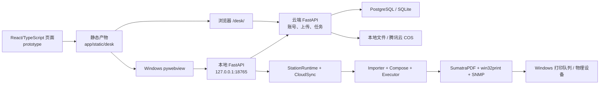

# 00-项目总控

> 项目概览，依据当前源码和已核实的现场记录整理。生产环境和真机验证情况见 [待办清单](TODO.md)。详细历史保存在 [整理前归档](archive/2026-10-09-整理前/PROJECT.md)。

## 总体架构

项目由云端 FastAPI、共享业务界面和 Windows 印务台组成。云端管理账号、学校、任务、文件及状态；客户端用 pywebview 显示本地 FastAPI 页面，由本机服务代理云端 API 并连接 Windows 打印队列。独立 agent、CUPS 和模拟打印后端已退役。

## 模块入口

| 位置 | 职责 |
|---|---|
| `prototype/` → `app/static/desk/` | React、TypeScript、Tailwind CSS 业务界面及 Vinext/Vite 构建产物；网页和客户端共用。 |
| `app/server_web.py`、`app/storage.py` | 云端账号、任务、上传、领取、同步及磁盘/COS 存储。 |
| `app/desktop.py`、`app/desktop_web.py` | pywebview 窗口、本地 API 网关与云端请求代理。 |
| `app/station_runtime.py`、`app/cloudclient.py` | 客户端生命周期、登录会话、任务同步、PDF 预缓存与领取。 |
| `app/importer.py`、`app/compose.py`、`app/executor.py`、`app/backends.py` | 班级 PDF 合成、固定设备分配、调度、状态判断及 Windows 打印控制；细节见 [02-打印](02-打印.md)。 |
| `app/db.py`、`app/models.py` | 云端与本地数据库结构、读写和状态定义。 |
| `deploy/`、`build_exe.ps1` | 云端部署模板与 Windows 客户端打包脚本。 |

## 运行方式

| 入口 | 默认地址 | 用途 |
|---|---|---|
| `python run.py server` | `0.0.0.0:8011` | 云端网页与 API；部署模板通过 systemd 启动，Nginx 模板反代到 `127.0.0.1:8011`。实际线上入口以现场配置为准。 |
| `python run.py desktop` 或 `python run.py` | `127.0.0.1:18765` | Windows 印务台；开发时也可用 `启动客户端.cmd` 从源码运行。 |
| `prototype/` 下 `npm run build` | 输出 `prototype/dist/client` | 将产物同步到 `app/static/desk` 后供网页和客户端使用。 |
| `build_exe.ps1` | 完整输出目录 | 构建前端并打包 Windows 客户端和独立更新启动器；脚本会安装依赖和运行 PyInstaller，不作为只读检查执行。 |

此前 Windows 前端构建曾在 Node 退出时触发 `uv_async` 断言；2026-10-15 客户端完整打包和隔离启动健康检查已通过。生产升级和真机验证另见 [待办清单](TODO.md)。

## 数据与业务主线

云端可使用 PostgreSQL 或 SQLite；PDF 可存本地磁盘或 COS。用户以签名会话 Cookie 登录。COS 上传先申请临时签名，前端优先直传，失败时经同源接口中转，最后调用完成确认并入队；细节见 [03-上传](03-上传.md)。

### 生产配置与 2026-10-15 故障

- 云端实际运行中的 `print-cluster` 进程已核实设置 `PRINT_CLOUD_DB_URL`，使用 Docker 容器 `postgresql`（镜像 `postgres:18.4-alpine`）中的 PostgreSQL；连接用户和数据库名均为 `printer`。`PRINT_DATA_DIR` 未设置，程序数据目录为 `/opt/print-cluster/data`。数据库连接串和密码不写入文档。`app/config.py` 在未设置 `PRINT_CLOUD_DB_URL` 时才回退到 SQLite `data/cloud.db`；这不是此次生产运行方式。
- 数据库连接、文件存储由运行进程的环境变量决定。2026-10-15 从运行中的服务进程核实：`PRINT_STORAGE_BACKEND=cos`、`COS_REGION=ap-shanghai`、`COS_PRESIGN_SECONDS=600`，且 `COS_BUCKET`、`COS_SECRET_ID`、`COS_SECRET_KEY` 均已设置。`app/storage.py` 使用这些环境变量访问 COS。桶名、密钥和数据库连接串不写入仓库文档。仓库根目录 `.env` 仅作为本地配置文件，不用于推断生产现场值。
- `deploy/print-cluster.service` 是仓库模板，含 `/etc/print-cluster.env`；2026-10-15 现场确认该文件不存在，不能以模板推断实际 systemd 配置。现场主机也未找到 `pg_dump`、`psql` 命令；PostgreSQL 客户端工具可能位于容器内，迁移时须核对容器和目标库。
- 提交 `018b2bd` 新增云端字段 `tasks.class_copies_json`、`tasks.cover_enabled`、`school_presets.overrides_json`。服务在旧库缺字段时按 `app/db.py` 校验主动拒绝启动，公网出现 502；不是退役旧代码影响数据库连接。2026-10-15 现场先切回 `0ad282e` 恢复网站，再通过容器内 `pg_dump` 备份 `printer` 库并用 `pg_restore -l` 核验归档，执行 [逐班份数与封面迁移](../deploy/migrations/20261015_class_copies.md)（事务显示三次 `ALTER TABLE` 和 `COMMIT`）。随后切回 `main` 的 `018b2bd`、安装依赖并重启。首次重启因此前 root shell 的 `umask 077` 使新检出源码不可由服务用户读取而失败；恢复跟踪文件读取及 `app` 目录遍历权限后，systemd 服务正常运行，公网 `/desk/`、`/login` 的 GET 均返回 200。更新清单 `/updates/stable.json` 尚未发布，返回 404 符合当前状态。真机打印和在线升级仍待验收。

Windows 客户端周期性同步并预缓存排队 PDF；用户选机打印时准备班级作业，再由云端原子领取任务。同一任务按班级固定分配打印机，每班合成一个 PDF 并提交一个 Windows 作业。完成和异常状态回传云端；全部班级完成后任务直接结束，异常班级由人确认或整班重打。详情见 [02-打印](02-打印.md)。

项目的未完成事项统一放在 [TODO.md](TODO.md)。Git 提交保存具体代码改动；聊天文档只在用户说“收尾”时用表格记本阶段结论，不复制逐文件差异。旧文档和历史方案在 [archive](archive/2026-10-09-整理前/PROJECT.md) 留存。
