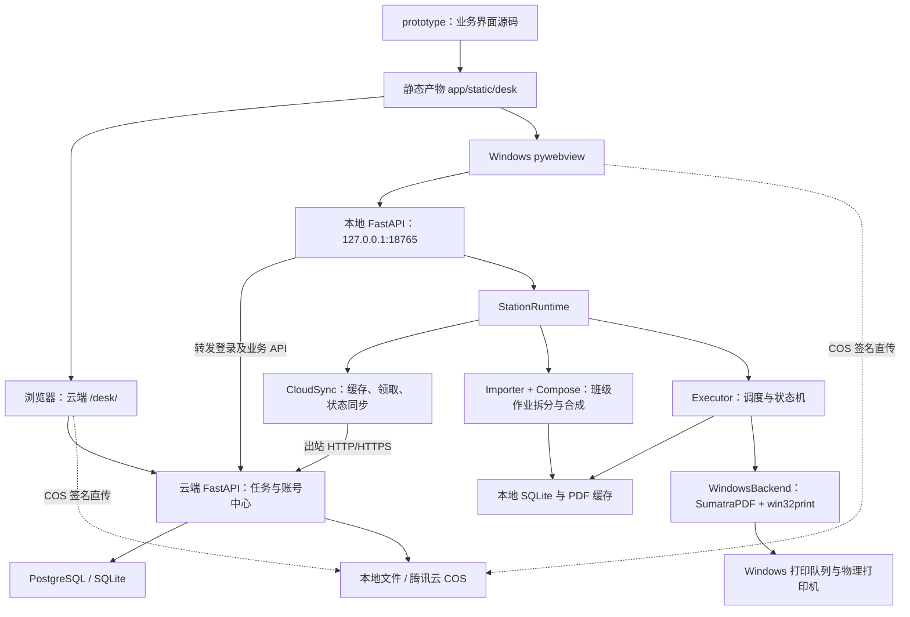

# CHAT-01 | PROJECT

> 更新：2026-10-08。本文依据当前工作区源码梳理，描述当前实现，不代表生产环境或真机已验收。历史方案见 [归档](../开发文档-历史设计.md)。

## 1. 总体架构

项目是“云端任务中心 + Windows 印务台 + 本地打印调度”的协同打印系统。云端维护账号、任务与文件，本地客户端负责连接 Windows 打印队列和实际出纸；旧独立 agent 运行方式已退役。

业务页面由 React、TypeScript、Tailwind CSS 编写，经 Vinext/Vite 构建为静态产物。网页与桌面端使用同一套业务界面；Windows 桌面通过 pywebview/Edge Chromium 显示本地 FastAPI 提供的页面，本地服务转发云端 API，并提供本机打印接口。

WindowsBackend 是正式桌面端唯一打印后端。

## 2. 运行入口和模块职责

所有路径均相对于项目根目录。

| 入口 | 默认监听 | 用途 |
|---|---|---|
| python run.py server | 0.0.0.0:8011 | 云端网页、账号、上传、队列与同步接口 |
| python run.py desktop 或 python run.py | 127.0.0.1:18765 | Windows 正式客户端、本地网关和内嵌打印站 |

端口以当前配置为准，云端默认值来自 config.py 的 8011。另有 invite 辅助入口用于服务器本机查看邀请码，不属于日常运行角色。

| 模块 | 职责 |
|---|---|
| app/server_web.py | 云端 FastAPI：账号、学校预设、任务、上传、领取、退役页面重定向与文件留存 |
| app/desktop.py、app/desktop_web.py | 桌面窗口和本地服务生命周期、登录转发、云端 API 代理、本机打印接口 |
| app/station_runtime.py | StationRuntime：会话绑定、打印机绑定、任务打印请求、整任务控制及异常班级人工处置；历史取件状态兼容 |
| app/cloudclient.py | CloudSync：周期同步、PDF 下载缓存、任务领取与释放请求 |
| app/importer.py、app/compose.py | 当前班级作业创建、逐份双面补白、PDF 合成；全部班级完成后直接结束任务 |
| app/executor.py | 后台调度循环、打印机轮询、完成判定、故障处理、连续运行与休息管理 |
| app/backends.py | Windows 打印队列提交与控制，SNMP 状态读取辅助 |
| app/db.py、app/models.py | 数据访问、当前 schema 创建与只读结构核验、状态枚举 |
| app/storage.py | 服务器磁盘/COS 文件访问、签名上传下载和删除 |
| app/config.py、app/webcommon.py | 环境配置、模板、密码校验及签名会话 |
| prototype/app、prototype/components、prototype/lib | 业务界面、当前使用的组件、云端及本机 API 调用 |
| tests、deploy、build_exe.ps1 | 回归测试、服务部署模板和 Windows 打包 |

## 3. 数据、身份与接口边界

### 云端

云端使用 PostgreSQL（配置 PRINT_CLOUD_DB_URL）或 SQLite（未配置时使用 data/cloud.db）。db.py 使用 SQL 和 psycopg/sqlite3 访问数据库，不是 ORM 架构。空库通过当前建表定义初始化；已有库只读核验必需字段，不支持的结构会报错停止，不自动 ALTER 或重建。

主要表：users、school_presets、tasks、task_events、config_kv。任务保存 PDF 位置和元数据，PDF 二进制存于服务器磁盘或 COS。当前权限角色为 superadmin 与 user；既有未知旧角色不会自动转换或提权，不要求注册账号绑定某所学校。

登录使用 pc_session 签名 Cookie，会话载荷包含有效期。桌面本地网关转发登录并保存本机来源的会话 Cookie；本机操作校验云端身份。本地网关限制主机名及请求 Origin，监听环回地址。客户端同步要求有效用户会话及匹配的 client_id；旧 X-Agent-Token 不再授权。

### 本地

桌面配置和数据默认保存在 %APPDATA%/CanonPrintDesk：
- client-settings.json：云端地址、客户端标识及可选端口等设置。
- browser：内嵌浏览器存储。
- station/local.db：打印机、本地任务、小组、事件、运行与休息记录。
- station/uploads、station/composed：下载原稿和合成打印 PDF。

Windows 印务台默认使用用户目录中的 station/local.db。主要表为 printers、local_tasks、groups、events、printer_run_sessions、printer_rest_sessions、config_kv；cloud_id 对接云端任务。local_tasks.job_model 保留历史模型标识，当前打印只接受 class 作业；暂停、已申请打印和选机列表持久化在本地，每个班级作业在 groups.printer_id 中保存固定设备分配。

### 主要接口

| 接口 | 用途 |
|---|---|
| /login、/register、/logout | 登录、注册及退出 |
| GET /api/v1/bootstrap | 业务页面快照 |
| /api/v1/account、/api/v1/admin/*、/api/v1/schools | 个人资料、公司管理及学校预设 |
| POST /api/v1/uploads/presign | 申请 COS 上传地址，或指示使用本地存储上传 |
| POST /api/v1/uploads/{tid}/file、/complete | COS 中转上传与完成确认 |
| POST /api/v1/tasks | 普通任务上传 |
| POST /api/v1/tasks/{tid}/claim、/release | 客户端领取及释放排队任务 |
| POST /api/agent/sync | 正式客户端通过会话 Cookie 与 client_id 回传任务状态、接收排队任务/取消/优先级 |
| GET /api/agent/file/{tid} | 正式客户端会话下载原稿，COS 模式可重定向到签名下载地址；独立 Token 不可访问 |
| /desktop/printers、/desktop/printers/available | 本机绑定和可用 Windows 队列 |
| /desktop/tasks/{tid}/print、/pickup、/control | 本机发起打印、历史取件状态兼容和任务控制 |
| GET /desktop/fleet | 本机机队任务视图 |

最后三类由本地网关提供；普通网页不负责操作用户电脑的打印队列。

## 4. 上传和打印数据流

1. 用户登录，界面读取业务快照。前端每次请求结束后约 5 秒再刷新快照；不是 SSE/WebSocket 推送。
2. 上传携带学校、年级、班级数及每班份数等属性，总份数按班级数计算。COS 模式创建 UPLOADING 占位记录，签发临时 PUT 地址。
3. 前端优先直传 COS；失败时通过同源接口中转到同一对象。中转上限为 200 MB；仍需调用 complete 核实对象存在并入队。该确认不能理解为服务器已完整解析验证 PDF。本地存储模式走普通上传接口。
4. 登录后的桌面客户端周期性缓存尚未开始的排队 PDF，缓存不等于领取，也不自动打印。
5. 正式桌面用户选机点击打印。本地检查任务元数据；若尚无本地任务，先下载原稿并按班级数生成每班独立 PDF，再请求云端 claim。旧模型本地任务不会自动转换或下发；界面提示取消旧任务并重新提交。实际顺序是“本地准备 → 云端领取 → 启用派发”。
6. 云端通过条件 UPDATE 将未领取的排队任务绑定到 claimed_client_id，避免多个桌面客户端同时领取。同一客户端的排队任务领取可幂等返回；领取成功后本地才启用实际派发。
7. 正式桌面端按稳定打印机顺序均分连续班级编号，保存班级到设备的分配后派发；每班完整交给一台设备。故障班级留在原设备等待人工处理，健康设备继续执行各自班级。
8. 全部班级完成后，本地任务直接记为 DONE 并触发 CloudSync 同步；云端校验桌面客户端是否为领取方。异常班级由人确认完成或整班重打；历史 AWAITING_PICKUP 状态在本地启动时核对班级完成情况后关闭。

常规状态链为 QUEUED → PRINTING → DONE，另有 CANCELED；UPLOADING 是上传过程的中间状态。AWAITING_PICKUP 仅为历史兼容状态。

默认本地轮询间隔 2 秒、云同步间隔 30 秒。桌面模式将同步放入独立线程以避免网络请求直接阻塞调度。同步失败记录 last_error 并在后续周期重试；已准备且已启用的本地任务可以继续调度。不要据此推断存在完整离线领取、到期租约回收或所有事件可靠补传机制。

## 5. 打印执行和设备边界

正式桌面端使用 pypdf 将某班全部副本拼成一个 PDF，不生成封面或程序间隔页；Windows 驱动每个 PDF 提交一份，长边双面、黑白。双面打印时奇数页原稿逐份补白，避免后一份首页落在前一份背面。每班是一个完整作业，不按 80 张安全线拆分。打印机间隔页由设备设置负责，程序不修改该设置。

WindowsBackend 用 SumatraPDF 将合成文件按一份、长边双面、黑白提交到已安装的 Windows 队列。客户端不安装打印机驱动。暂停、恢复、取消通过合成文件名匹配本程序作业，不清空其他应用作业。异常班级整班重打时先检查原设备队列：匹配到旧作业只取消该作业；未匹配且队列有其他作业则阻塞；未匹配但队列为空、设备空闲时，需人工二次确认并复查后重派原班。

设备状态包括 OFFLINE、IDLE、PRINTING、WAIT_PAPER、SUSPECT、QUARANTINED、RESTING、MAINTENANCE。状态来源优先尝试 SNMP，再使用后端队列信息。完成判定涉及回空闲、稳定等待及可用的计数信息；系统队列结束不能当作真机出纸绝对可靠的证明。

连续运行计时、休息记录及故障处理在本地进行。达到阈值后按执行器逻辑停止接新班级并在当前作业边界休息。班级作业状态不确定时会保留在原设备并阻塞，等待人工确认或重打，不自动转派或重打。

桌面按用户选机请求调度，可让不同打印机处理不同任务。旧 agent Token 不再用于同步或文件下载。

## 6. 配置、部署和验证

| 配置项 | 当前用途/默认值 |
|---|---|
| PRINT_PORT | 云端默认 8011 |
| PRINT_CLOUD_URL、PRINT_CLOUD_DB_URL | 云端地址、可选 PostgreSQL 连接 |
| PRINT_DATA_DIR、PRINT_STORAGE_BACKEND | 数据目录、local 或 cos（默认 local） |
| COS_REGION、COS_BUCKET、COS_SECRET_ID、COS_SECRET_KEY | 服务器端 COS 配置；密钥不可写入客户端或文档 |
| PRINT_BOOTSTRAP_ADMIN_PASSWORD、PRINT_SECRET | 首次管理员初始化及会话签名配置 |
| PRINT_SYNC_INTERVAL、PRINT_POLL_INTERVAL | 默认 30 秒、2 秒 |
| PRINT_RETENTION_DAYS | 云端原稿留存默认 30 天 |
| SUMATRA_PATH | Windows PDF 打印组件路径 |

桌面运行时显式使用 WindowsBackend 和手动发起打印。文件清理与数据库台账分开，云端后台周期清理原稿；不能将云端留存设置理解为桌面缓存也已自动按同样策略清理。

部署模板：deploy/print-cluster.service 运行 python run.py server；deploy/nginx-print-cluster.conf 反代到 127.0.0.1:8011，上传上限 200m。仓库 Nginx 模板监听 80，不包含完整 TLS 配置；生产 HTTPS 需由部署环境提供。

前端在 prototype 内执行 npm run build，产物 prototype/dist/client 复制至 app/static/desk。build_exe.ps1 自动完成构建、资源复制、依赖安装、SumatraPDF 准备及 PyInstaller 打包；分发完整输出目录，不能仅移动 EXE。

unittest 覆盖账号权限与旧角色不提权、上传/COS 降级、桌面网关、缓存与领取互斥、旧任务阻断、按班级合成、固定多机分配、故障阻塞、直接完成任务、异常重打的队列核对、schema 核验和 Windows 作业精确控制。2026-10-08 `python -m unittest discover -s tests`：53 项通过。`prototype` 下 `npx tsc --noEmit` 通过。`npm run build` 完成编译与 2 条静态路线预渲染，但 Node 在 Windows 退出阶段触发 `uv_async` 断言并返回 1；构建不记为通过。生成的客户端静态文件已同步到 `app/static/desk`。没有运行真实打印、桌面客户端或生产数据库。

## 7. 与旧设计的主要区别

| 历史描述 | 当前源码 |
|---|---|
| R2 文件中心 | 本地磁盘或腾讯云 COS |
| 短期访问令牌及刷新协议 | 签名会话 Cookie 与 client_id |
| SSE/WebSocket 实时事件 | 页面轮询与周期同步 |
| 有到期时间的领取租约 | claimed_client_id 条件领取；未实现完整到期回收机制 |
| 领取后才允许下载他人文件 | 登录桌面客户端可预缓存排队 PDF，领取约束实际打印启用 |
| 所有场景全局单任务闸口 | 桌面允许不同设备并行不同任务 |

后续开发应更新本文与对应任务记录，不将历史设计直接当作当前行为。
